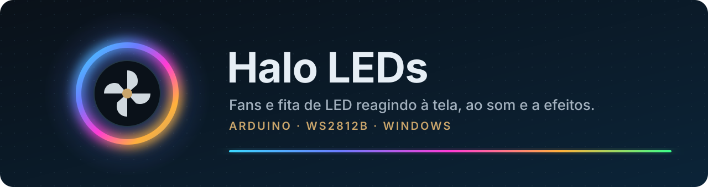
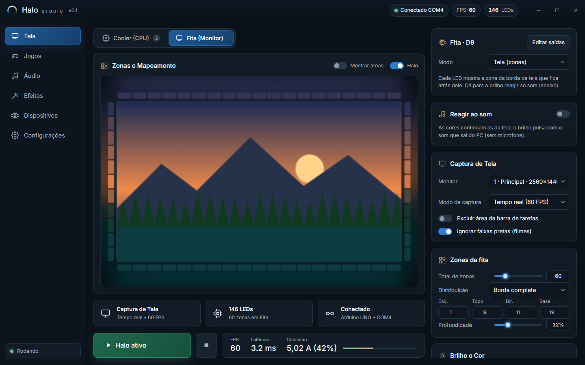
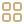
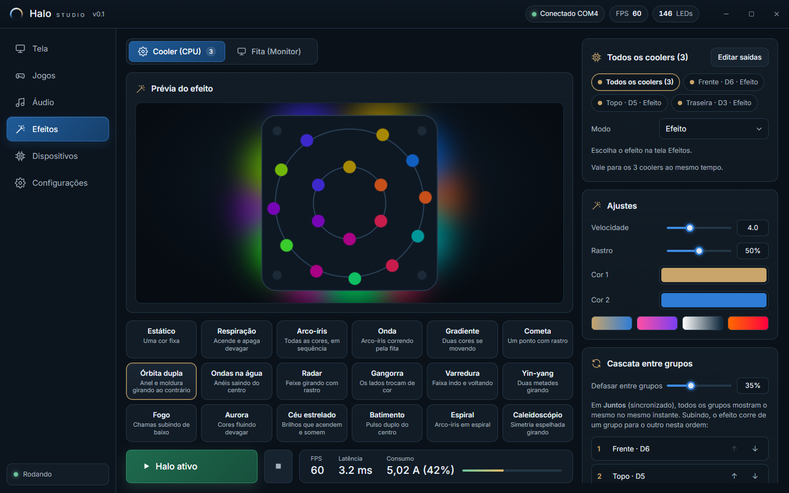
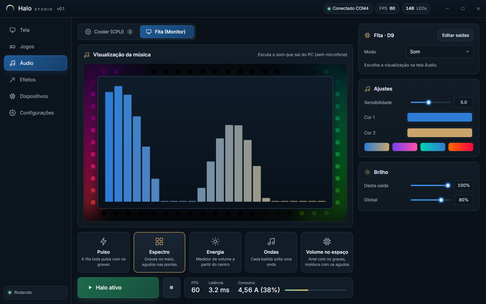
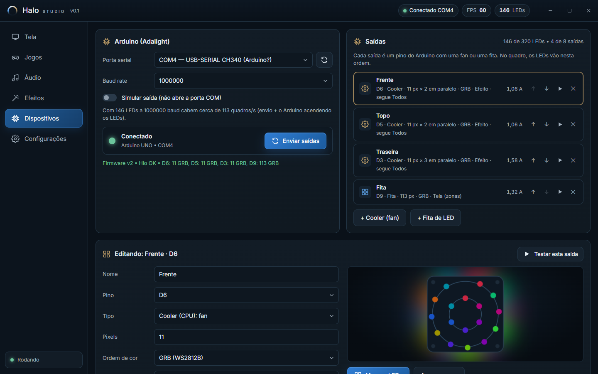
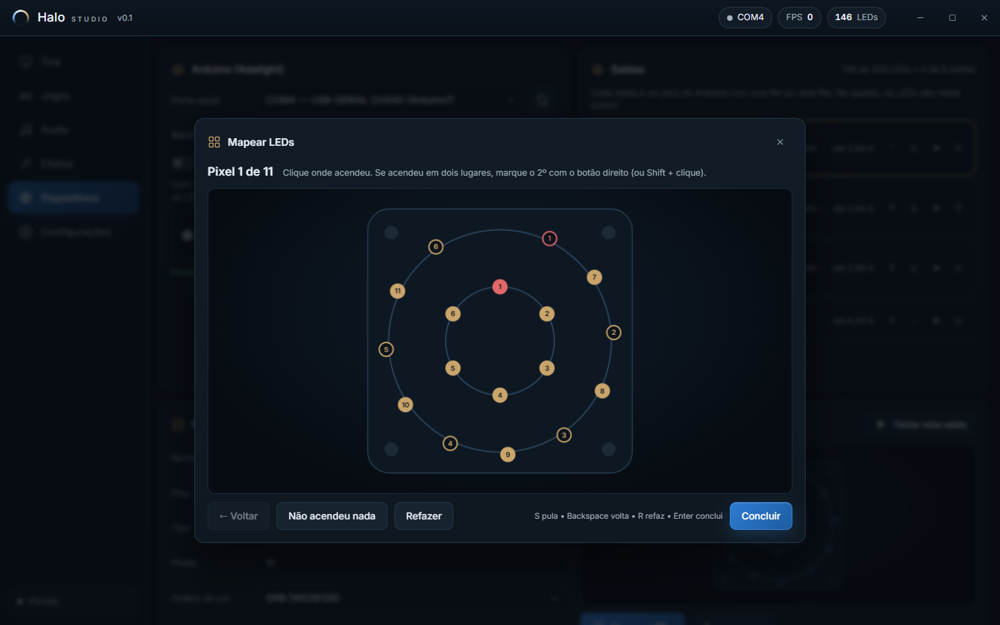
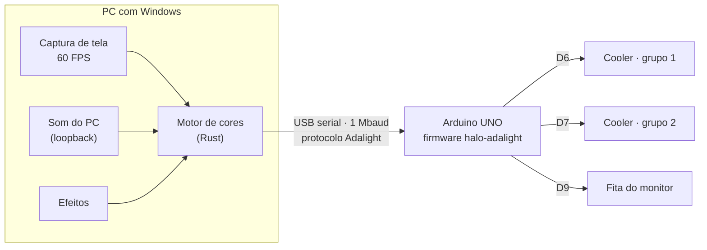
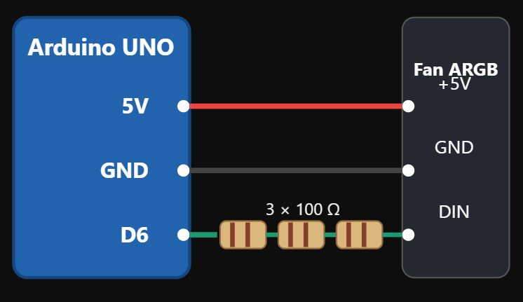

<p align="center">
  
</p>

<p align="center">
  <a href="https://github.com/Everteson/halo-leds/releases"></a>
  
  
  
  
  <a href="LICENSE"></a>
</p>

<p align="center">
  Controle de LEDs endereçáveis (ARGB) do PC, sem software de fabricante.<br>
  Um <b>Arduino</b> de poucos reais vira o controlador; o app no Windows decide as cores, até 60 vezes por segundo.
</p>

<p align="center">
  
</p>

---

## Recursos

<table>
  <tr>
    <td width="33%" valign="top">
      <br>
      <b>Tela</b><br>
      A fita atrás do monitor acompanha a borda da imagem por zonas. As fans pegam a cor dominante da cena.
    </td>
    <td width="33%" valign="top">
      <br>
      <b>Som</b><br>
      Os LEDs pulsam com os graves e as explosões. Dá para juntar com a tela: cor da cena, força do som.
    </td>
    <td width="33%" valign="top">
      <br>
      <b>Efeitos</b><br>
      Mais de 15 efeitos (órbita, radar, ondas, fogo, aurora, caleidoscópio) que usam a posição real de cada LED.
    </td>
  </tr>
  <tr>
    <td valign="top">
      <br>
      <b>Várias saídas</b><br>
      Até 8 pinos no Arduino, cada um com tipo (Cooler ou Fita), quantidade de LEDs e ordem de cor próprios.
    </td>
    <td valign="top">
      <br>
      <b>Todos os coolers juntos</b><br>
      Um efeito para todos os grupos de fans, sincronizado ou em cascata, ou ajustes separados por grupo.
    </td>
    <td valign="top">
      <br>
      <b>Liga e esquece</b><br>
      Inicia com o Windows, fica na bandeja, acha o Arduino mesmo se mudar de porta USB e religa as luzes.
    </td>
  </tr>
</table>

## Telas

<table>
  <tr>
    <td width="50%"><br><sub><b>Efeitos</b>: todos os coolers juntos, com prévia na fan.</sub></td>
    <td width="50%"><br><sub><b>Áudio</b>: graves e agudos do que toca no PC.</sub></td>
  </tr>
  <tr>
    <td><br><sub><b>Dispositivos</b>: uma saída por pino, com limite de corrente.</sub></td>
    <td><br><sub><b>Mapeamento</b>: clique onde cada LED acendeu.</sub></td>
  </tr>
</table>

## Como funciona



O app manda um quadro de cores por vez e o Arduino confirma cada um, então não há perda nem atraso acumulado. O protocolo está em [`PROTOCOLO.md`](firmware/halo-adalight/PROTOCOLO.md).

## Peças

| | Peça | Observação |
|---|---|---|
|  | Arduino **UNO** ou **Nano** | Clone com CH340 serve. Até 320 LEDs no total |
|  | LEDs **WS2812B** de 5 V | Fita ou fans ARGB de 3 pinos |
|  | 1 resistor de **220–470 Ω** por saída | No fio de dados |
|  | **5 V da fonte do PC** (Molex ou SATA) | Fio de 18–20 AWG; nada de jumper fino |

## Ligação

<p align="center">
  
</p>

```
Arduino Dx ──[220 Ω]── DIN dos LEDs        (x = 2 a 9, um pino por saída)
Fonte 5V ───────────── +5V dos LEDs
Fonte GND ──┬───────── GND dos LEDs
            └───────── GND do Arduino     (terra em comum)
```

> [!IMPORTANT]
> Para mais de uma fan, os LEDs devem receber os 5 V **da fonte**, não do Arduino. O diagrama acima é o teste com uma fan só, no 5 V do Arduino.

> [!WARNING]
> Confira com um **multímetro** qual fio da fonte é 5 V antes de ligar. O Molex também tem **12 V**, que queima os LEDs na hora.

<details>
<summary><b>Dicas de ligação</b></summary>

- O conector ARGB de 3 pinos é **+5V, DADOS, (vazio), GND**. A seta no plástico marca o +5V.
- Na fita, o dado entra pela ponta de onde **sai a seta** (DIN).
- Fans com cabo "macho e fêmea" costumam ser **em paralelo**: todas repetem o mesmo sinal. Para controlar cada fan, ou grupo, separado, ligue cada um num pino.
- Fitas longas: ligue o 5 V nas duas pontas, para o branco não amarelar no fim.

</details>

## Instalação

 **1. App:** baixe o instalador em [**Releases**](https://github.com/Everteson/halo-leds/releases) e instale. É só para o seu usuário e não pede administrador.

> [!NOTE]
> O instalador não é assinado. Se aparecer "O Windows protegeu o computador", clique em **Mais informações** → **Executar assim mesmo**.

 **2. Firmware:** abra [`firmware/halo-adalight/halo-adalight.ino`](firmware/halo-adalight/halo-adalight.ino) no Arduino IDE, instale a biblioteca **FastLED** e grave como **Arduino UNO**.

 **3. Configurar:** no app, em **Dispositivos**, cadastre cada saída (pino, Cooler ou Fita, quantidade de LEDs, ordem de cor). Depois use o **assistente de mapeamento** para marcar onde fica cada LED da fan.

Detalhes de cada modo e de cada ajuste: [`halo-studio/README.md`](halo-studio/README.md).

## Ferramenta de teste

 [`tools/led-test`](tools/led-test) acende os LEDs direto pelo Arduino, sem o app. Serve para contar LEDs, conferir as cores, configurar as saídas e fazer teste de carga.

```bash
cd tools/led-test
npm install
node led-test.mjs andar --leds 30        # um LED por vez
node led-test.mjs config 6:11:GRB 9:113:GRB
node led-test.mjs info
```

## Compilar do código

 Precisa de **Rust** (toolchain MSVC), **Node.js** e das **Build Tools do Visual Studio**.

```bash
cd halo-studio
npm install
npm run build        # gera o instalador em src-tauri/target/release/bundle/nsis
```

## Segurança

 Cada saída tem **limite de corrente** no app (padrão de 6 A), e o firmware tem um teto próprio. Mesmo assim:

- Use fios da grossura dos fios da fonte e prefira **solda** ou **borne** a encaixes de jumper.
- Fio **morno** com tudo em branco é normal; fio **quente** demais para segurar não é.
- Isole bem as emendas e prenda os cabos longe das fans.

## Licença

[MIT](LICENSE). Use, modifique e compartilhe à vontade.
